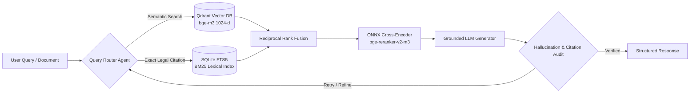

<div align="center">

<!-- THEME-ADAPTIVE HEADER TYPING SVG -->
<picture>
  <source media="(prefers-color-scheme: dark)" srcset="https://readme-typing-svg.demolab.com?font=JetBrains+Mono&weight=700&size=26&duration=3500&pause=1000&color=58A6FF&center=true&vCenter=true&multiline=true&repeat=true&width=850&height=85&lines=Nguyen+Thanh+Duy+Tan+%7C+AI+Engineer;Production+RAG+%E2%80%A2+Multi-Agent+Systems+%E2%80%A2+Computer+Vision" />
  <source media="(prefers-color-scheme: light)" srcset="https://readme-typing-svg.demolab.com?font=JetBrains+Mono&weight=700&size=26&duration=3500&pause=1000&color=0969DA&center=true&vCenter=true&multiline=true&repeat=true&width=850&height=85&lines=Nguyen+Thanh+Duy+Tan+%7C+AI+Engineer;Production+RAG+%E2%80%A2+Multi-Agent+Systems+%E2%80%A2+Computer+Vision" />
  
</picture>

<sub><b>Designing low-latency retrieval pipelines, autonomous multi-agent workflows, and multimodal vision/OCR systems.</b></sub>

<br/><br/>

<!-- CONTACT & STATUS BADGES -->
[](mailto:tanntd.2005@gmail.com)
[](https://github.com/TanNguyen234)
[](#)
[](#)

</div>

---

> [!IMPORTANT]
> **Open to Opportunities:** Actively seeking **AI Engineer (Intern / Fresher)** opportunities in Ho Chi Minh City (or Remote). Dedicated to designing, building, and deploying scalable machine learning pipelines, intelligent retrieval systems, and end-to-end AI applications.

---

### ⚡ Engineering Snapshot

```diff
+ Hybrid RAG & Retrieval   : BAAI/bge-m3 + bge-reranker-v2-m3 (ONNX Runtime) | Qdrant Vector + SQLite FTS5
+ Multi-Agent Workflows    : LangGraph state machines, structured tool calling, deterministic validation
+ Vision, OCR & Audio AI   : YOLOv8/v11, SAM 2, PaddleOCR (120K+ synthetic Vi-Manga dataset), faster-whisper
+ MLOps & Backend Systems  : FastAPI, Docker, LightGBM/XGBoost/CatBoost ensembles, Optuna, PostGIS/SQL
```

---

### 🚀 Featured Production & Research Repositories

<!-- BENTO GRID 2x2 LAYOUT -->
<table width="100%">
  <tr>
    <td width="50%" valign="top">
      <h4>⚖️ <a href="https://github.com/TanNguyen234/VietLex-Tech-Spec">VietLex — Large-Scale Legal Hybrid RAG</a></h4>
      <p><sub>Production-oriented Vietnamese legal retrieval engine indexing <b>518,255+ statutory documents</b> with strict citation grounding and zero-hallucination guardrails.</sub></p>
      <ul>
        <li><b>Hybrid Search:</b> Dense vector retrieval (<code>Qdrant</code> + <code>bge-m3</code>) fused with lexical search (<code>SQLite FTS5</code>).</li>
        <li><b>Inference Optimization:</b> Cross-encoder reranking via <code>bge-reranker-v2-m3</code> accelerated on <code>ONNX Runtime</code>.</li>
      </ul>
      <p>
        <kbd>Python</kbd> <kbd>FastAPI</kbd> <kbd>Qdrant</kbd> <kbd>BGE-M3</kbd> <kbd>ONNX Runtime</kbd> <kbd>SQLite FTS5</kbd>
      </p>
    </td>
    <td width="50%" valign="top">
      <h4>🤖 <a href="https://github.com/TanNguyen234/CV-Review-System">Multi-Agent AI CV & JD Scoring System</a></h4>
      <p><sub>Autonomous candidate evaluation pipeline that parses complex resume layouts, benchmarks against job descriptions, and generates actionable gap analysis.</sub></p>
      <ul>
        <li><b>Agentic Workflow:</b> Orchestrated specialized parser, rubric evaluator, and critic agents via <code>LangGraph</code>.</li>
        <li><b>Structured Output:</b> Deterministic JSON schema scoring for technical skills, project depth, and ATS compatibility.</li>
      </ul>
      <p>
        <kbd>LangGraph</kbd> <kbd>Multi-Agent</kbd> <kbd>Python</kbd> <kbd>Prompt Engineering</kbd> <kbd>FastAPI</kbd>
      </p>
    </td>
  </tr>
  <tr>
    <td width="50%" valign="top">
      <h4>🛡️ <a href="https://github.com/TanNguyen234/End-to-End-Real-Time-Fraud-Detection-Pipeline">End-to-End Real-Time Fraud Detection</a></h4>
      <p><sub>High-throughput financial anomaly detection pipeline engineered for extreme class imbalance and sub-second transaction scoring.</sub></p>
      <ul>
        <li><b>Ensemble Modeling:</b> Gradient boosting pipeline (<code>LightGBM</code>, <code>XGBoost</code>, <code>CatBoost</code>) tuned with <code>Optuna</code>.</li>
        <li><b>Production Pipeline:</b> Automated feature engineering, threshold calibration (PR-AUC optimization), and API serving.</li>
      </ul>
      <p>
        <kbd>LightGBM</kbd> <kbd>XGBoost</kbd> <kbd>CatBoost</kbd> <kbd>Optuna</kbd> <kbd>Scikit-Learn</kbd> <kbd>MLOps</kbd>
      </p>
    </td>
    <td width="50%" valign="top">
      <h4>👁️ Multimodal Vision, OCR & Speech Pipelines</h4>
      <p><sub>Applied Deep Learning across synthetic document understanding, medical imaging, and low-latency voice synthesis.</sub></p>
      <ul>
        <li><b>Vietnamese Manga OCR:</b> Generated <b>120,000+ synthetic text-in-wild images</b> with custom font/noise augmentation for <code>YOLOv8/v11</code> & <code>PaddleOCR</code>.</li>
        <li><b>Real-Time Speech & Medical CV:</b> Chest X-ray abnormality grounding & Vietnamese Speech-to-Speech cloning (<code>faster-whisper</code> + <code>Silero VAD</code>).</li>
      </ul>
      <p>
        <kbd>PyTorch</kbd> <kbd>YOLOv11</kbd> <kbd>SAM 2</kbd> <kbd>PaddleOCR</kbd> <kbd>OpenCV</kbd> <kbd>faster-whisper</kbd>
      </p>
    </td>
  </tr>
</table>

<details>
<summary><b>🔍 Click to expand: Reference Hybrid RAG & Multi-Agent System Architecture (Mermaid.js)</b></summary>
<br/>



</details>

---

### 🛠️ Technical Stack & Tooling

<table width="100%">
  <tr>
    <td width="25%"><b>Category</b></td>
    <td width="75%"><b>Technologies & Frameworks</b></td>
  </tr>
  <tr>
    <td><b>AI / Deep Learning</b></td>
    <td>
      <kbd>PyTorch</kbd> <kbd>ONNX Runtime</kbd> <kbd>Ultralytics YOLOv8/v11</kbd> <kbd>SAM 2</kbd> <kbd>LightGBM</kbd> <kbd>XGBoost</kbd> <kbd>CatBoost</kbd> <kbd>Optuna</kbd> <kbd>Scikit-learn</kbd>
    </td>
  </tr>
  <tr>
    <td><b>LLM, RAG & Agents</b></td>
    <td>
      <kbd>LangGraph</kbd> <kbd>Sentence-Transformers</kbd> <kbd>BAAI/bge-m3</kbd> <kbd>Qdrant</kbd> <kbd>SQLite FTS5</kbd> <kbd>BERTopic</kbd>
    </td>
  </tr>
  <tr>
    <td><b>Vision, Audio & OCR</b></td>
    <td>
      <kbd>OpenCV</kbd> <kbd>PaddleOCR</kbd> <kbd>EasyOCR</kbd> <kbd>faster-whisper</kbd> <kbd>Silero VAD</kbd> <kbd>FFmpeg</kbd>
    </td>
  </tr>
  <tr>
    <td><b>AI Serving & MLOps</b></td>
    <td>
      <kbd>Python</kbd> <kbd>FastAPI</kbd> <kbd>Docker</kbd> <kbd>PostgreSQL</kbd> <kbd>SQLite</kbd> <kbd>Linux</kbd>
    </td>
  </tr>
</table>

<div align="center">
  <br/>
  
</div>

---

### 📊 GitHub Telemetry & Engineering Activity

<div align="center">

<picture>
  <source media="(prefers-color-scheme: dark)" srcset="https://github-stats-extended.vercel.app/api?username=TanNguyen234&show_icons=true&theme=tokyonight&hide_border=true&bg_color=0D1117&title_color=58A6FF&icon_color=58A6FF&text_color=C9D1D9" />
  <source media="(prefers-color-scheme: light)" srcset="https://github-stats-extended.vercel.app/api?username=TanNguyen234&show_icons=true&theme=default&hide_border=true&title_color=0969DA&icon_color=0969DA" />
  
</picture>
<picture>
  <source media="(prefers-color-scheme: dark)" srcset="https://streak-stats.demolab.com?user=TanNguyen234&theme=tokyonight&hide_border=true&background=0D1117&ring=58A6FF&fire=58A6FF&currStreakLabel=58A6FF" />
  <source media="(prefers-color-scheme: light)" srcset="https://streak-stats.demolab.com?user=TanNguyen234&theme=default&hide_border=true" />
  
</picture>

</div>

<details>
<summary><b>🎓 Academic Background & Milestones</b></summary>
<br/>

* **B.S. in Information Technology & Computer Science** — *Ho Chi Minh City University of Natural Resources and Environment (HCMUNRE)*
* **Academic Merit Scholarship Recipient** (*Học bổng Khuyến học*)
* **Research & Competition Highlights:**
  * Built a **200-page Headless Academic AI Text Detector & Citation Auditor** for `.docx` and `.pdf` theses.
  * Conducted spatial flood-risk modeling and environmental GIS analysis across Central & South-Central Vietnam (`GDAL`, `Rasterio`, `PostGIS`).
  * Mathematics & Artificial Intelligence Academic Olympiad participant.

</details>

---

> [!TIP]
> **Let's Connect:** Always open to collaborations, technical exchanges, and discussing new opportunities in AI & software engineering. Feel free to connect via [**tanntd.2005@gmail.com**](mailto:tanntd.2005@gmail.com).
